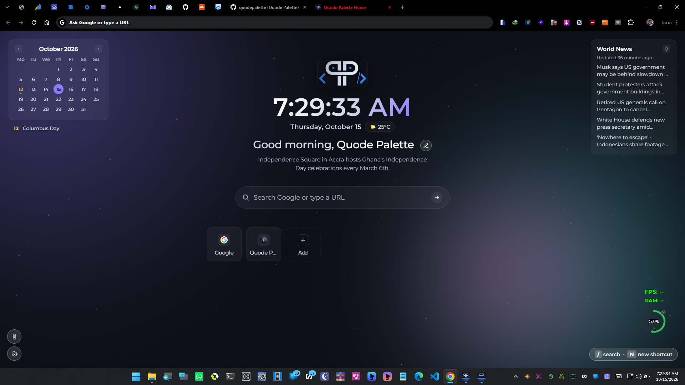

# Quode Palette Home: Personal New Tab Extension

A dark, animated personal new-tab page for Chrome and Brave.

  

## What's inside
- Live clock (with seconds) + date, time-aware greeting
- Google search bar (autofocus, press `/` anytime to jump to it)
- Unlimited shortcuts, always sorted alphabetically
  - Click **Add** (or press `N`) to add a shortcut
  - Hover any tile to reveal pin (star) / edit (pencil) / delete (trash) icons
  - **Pinned shortcuts** float to the top of the list, marked with a small gold dot
  - Deleting asks for confirmation via a toast at the bottom
  - Favicons load automatically; if one fails, a colored monogram is shown instead
- **Today-in-history line** under the greeting - pulls a real, Africa-related event from Wikipedia's "on this day" feed when one exists for the date; otherwise shows a rotating Africa-focused fact
- **Weather** - click the pill next to the date to grant location access once; shows temp + condition, refreshes every 30 min, cached so it doesn't hammer the API
- **Quick notes** - bottom-left notepad icon opens a small scratchpad that autosaves as you type
- **Settings panel** (gear icon, bottom-left) - **Export data / Import data** - one JSON backup with your shortcuts, notes and name, or re-detect your location for weather
- Animated dark "aurora" background (violet/cyan/magenta blobs drifting slowly) plus a second layer of soft glowing particles drifting upward for extra depth - both respect `prefers-reduced-motion`
- **Mini calendar** (top-left) - current month, today highlighted, with prev/next navigation and public holidays highlighted (hover a day for its name)
- **World news** (top-right) - top 5 BBC World headlines, click to open, manual refresh button, cached for 45 minutes. Fetched directly from BBC's RSS feed (no third-party proxy) via the `host_permissions` grant in `manifest.json`
- Everything is stored locally in the browser via `chrome.storage.local` - nothing leaves your machine except: favicon lookups, Google searches, the Wikipedia "on this day" call, the BBC World news feed (fetched directly, no proxy), and (only after you opt in) a weather lookup via Open-Meteo using your coordinates

## Install (Chrome or Brave - same steps)
1. Unzip this folder somewhere permanent (don't delete it after installing - the browser loads directly from these files).
2. Go to `chrome://extensions` (Brave: `brave://extensions`).
3. Turn on **Developer mode** (top-right toggle).
4. Click **Load unpacked** and select the extracted folder.
5. Open a new tab - you're in.

## Customizing
- **Shortcuts**: start empty - add your own with the **+** tile.
- **Your name**: click the pencil icon next to the greeting.
- **Colors**: all theme colors are CSS variables at the top of `style.css` (`--violet`, `--cyan`, `--magenta`, `--accent`, etc.) - tweak those to shift the whole palette.
- After editing any file, go back to `chrome://extensions` and hit the refresh icon on the extension card, then reload your new tab.

## Notes
- This is a one-off personal build, not intended for the Chrome Web Store - "Load unpacked" is the right way to run it permanently.
- Shortcuts are stored per-browser-profile (via `chrome.storage.local`), so they won't automatically sync between different computers unless you copy the extension folder and manually re-add them, or I switch you to `chrome.storage.sync` later if you want that.
- The weather pill triggers a normal browser geolocation permission prompt the first time you click it - nothing happens until you do.
- The export/import backup covers shortcuts (name, URL, pinned), notes and your name. Weather location isn't included. Older shortcuts-only backups can still be imported.
- The calendar and news panels hide automatically on narrower browser windows (under ~980px) so they don't crowd the center content.

## License

Released under the [PolyForm Noncommercial License 1.0.0](LICENSE). You are free to use, modify and share it for personal, educational and other noncommercial purposes. For commercial use, please get in touch.
[Email Us](mailto:hello@quodepalette.com)

